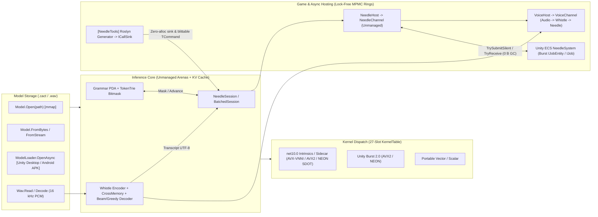

# needle-cs: Architecture & Complete Public API Briefing

**needle-cs** is a clean-room, unsafe/zero-allocation C# inference engine for [**Needle 3**](https://huggingface.co/Cactus-Compute/needle3) (schema-constrained tool calling, structured extraction, retrieval, embeddings) and [**Whistle**](https://huggingface.co/Cactus-Compute/whistle) (on-device encoder-decoder speech-to-text and voice-to-tool-calling).

It executes `.cact` model archives directly from memory-mapped files or raw byte buffers using hardware SIMD (`AVX-VNNI-INT8`, `AVX-VNNI`, `AVX2+FMA`, `ARM64 NEON DotProd/Widening`), Unity Burst 2.0, or a pure portable C# fallback—targeting `.NET 10` (NativeAOT & JIT) and `netstandard2.1` (Unity 7 CoreCLR & IL2CPP).

---

## 1. Architecture Overview

### High-Level Data Flow



### How It Works Under the Hood

1. **In-Place `.cact` Memory Mapping & Codebook Quantization (`Model.cs`, `ModelMemory.cs`)**
   - `Model.Open` validates the 196-byte `.cact` header (`ModelInfo.SupportedMagic = 0x05E12A84`), validates all tensor record bounds, and maps weight pages directly from disk (optionally pre-faulting pages via `Prefault()` or advising `MADV_HUGEPAGE` under Linux when `NEEDLE_HUGEPAGES=1`). On platforms without `mmap` (Android APK assets), `Model.FromBytes` / `Model.FromStream` / `ModelLoader.OpenAsync` supply unmanaged copies.
   - Weight matrices are stored in `Cq` codebook-quantized blocks (`GroupSize = 128`, 2-bit or 4-bit packed indices into a shared `Codebook` with `Levels[16]`, byte lookup tables `Bytes[32]`, and FP16 group norms). During GEMV/GEMM, input vectors are dynamically quantized per 128-element group to `sbyte` (`Activations`), allowing high-throughput integer multiply-accumulate instructions (`vpdpbusd` / `vpdpbssd` / `vpmaddubsw` / `sdot`).

2. **Model Architecture (`Model.cs`, `Engine.cs`, `Audio.cs`)**
   - **Multi-Stream Hyper-Connections & Sinkhorn Mixing**: `Lanes = 4` residual streams mixed via `Sinkhorn4x4` doubly-stochastic matrices (`HyperConnections`) with pre/post/residual dynamic phi projections.
   - **Engram Conditional Memory**: Sparse n-gram embedding tables (`EngramSite`) at configured layer indices with causal convolution taps.
   - **Attention & KV Cache**: Grouped-Query Attention (GQA) with sliding window + global layer mask (`Geometry.IsGlobal(layer)`), 3-tap causal convolutions (`ConvTaps = 3`) on Q/K/V projections, Q/K RMS normalization, RoPE, and sigmoid attention gating (`AttnGate`).
   - **Kronecker-Factored Hadamard MLP (`MlpWeights`, `HadamardMlp`)**: Three Kronecker-structured transforms (`W1A`/`W1B`, `W2A`/`W2B`, `W3A`/`W3B`) interleaved with permutations (`PermA`, `PermB`), input-conditioned gating (`CondV`, `CondU`), and diagonal scales (`D1`–`D4`).
   - **Probe Head (`ProbeHead`)**: Powers both (a) neural **Confidence Scoring** (`HeadConfidence`), combined conservatively via `min(HeadConfidence, DecodeConfidence)` where `DecodeConfidence` is the geometric mean token probability over the tool call, (b) dense text embeddings (`NeedleSession.Embed`), and (c) automatic **Top-K Tool Shortlisting** when tool count exceeds `NeedleOptions.RetrievalTopK` (default `5`).

3. **Byte-Level Pushdown Grammar & Constrained Decoding (`Grammar.cs`, `TokenTrie.cs`, `NeedleSession.cs`)**
   - Tool definitions (JSON schemas or `[NeedleTools]` interfaces) compile into an integer bytecode automaton (`GrammarProgram`, max stack depth `GrammarState.MaxDepth = 16`).
   - `TokenTrie` holds the entire tokenizer byte trie plus a **64-slot mask cache** (`MaskCacheSlots = 64`) keyed by grammar state. At each decode step, `trie.Allow(...)` computes a bitmask over vocabulary IDs:
     - When `allowed <= 256` (`SparseHeadThreshold`), `Engine.LogitsForRows` evaluates **only the valid logit rows** instead of the full vocabulary matrix.
     - With `NeedleOptions.JumpForward = true`, chains where `allowed == 1` advance up to `MaxJumpChunk = 512` tokens in a single prefill chunk without redundant sampling steps.
     - With `NeedleOptions.PromptLookup = true`, `NeedleSession` speculatively drafts up to `MaxDraftTokens = 4` n-gram tokens from prompt/history constrained by a scratch grammar cursor, verifying them in one forward pass (`CheckpointSpec` / `RestoreSpec` on mismatch).
   - **Confidence Refusal & Primed Prefix Snapshots**: Calls with confidence below `NeedleOptions.RefuseBelow` (`0.1f` default) return `ReplyStatus.Refused` and place parsed calls in `SuppressedCalls` rather than `FunctionCalls`. Pre-evaluated `<system>` + `<tools>` KV cache state can be exported (`ExportPrimedPrefix()`) and passed to new sessions to skip prompt priming.

4. **Compile-Time Zero-Allocation Typed Commands (`Needle.Generators`, `CallSink.cs`, `Utf8Text.cs`)**
   - Marking a `partial interface` with `[NeedleTools]` triggers the `NeedleToolsGenerator` Roslyn incremental generator to emit:
     - `<Prefix>CommandKind : byte` enum + per-tool `<Tool>Args` blittable structs
     - Tagged union `<Prefix>Command` (`Kind`, `uint Presence` bitfield, tool arg fields)
     - Streaming parser struct `<Prefix>Sink : ICallSink<TCommand>` implementing `IGrammarSink`, populated byte-by-byte directly inside `Grammar.Advance` without ever building or parsing a JSON string at runtime
     - `<Prefix>Commands` static class (`Schema`, precompiled `Grammar*` spans, zero-alloc `Dispatch<THandler>`, fallback `TryBind`)
     - `<Prefix>ToolSet : IToolSet` on C# 11 / `.NET 7+` targets (`ToolSession.Open<TTools>(model, options)`).

5. **Lock-Free Unmanaged Host Channels & IPC (`NeedleChannel.cs`, `NeedleHost.cs`, `VoiceHost.cs`, `SharedChannel.cs`)**
   - `NeedleChannel` allocates a single 64-byte-aligned unmanaged slab containing two power-of-two lock-free MPMC rings (`requests`, `replies`), wake trampoline slots, and an atomic per-ticket cancellation bitmask (`Cancel(ulong ticket)`).
   - Game loops and Burst jobs call `TrySubmit*` / `TryReceive` / `Cancel` using blittable fixed-buffer structs (`ChannelRequest`, `ChannelReply`, `CallsUtf8` = 1024 B, `TextUtf8` = 2048 B, `QueryUtf8` = 512 B) with **0 B managed allocation**.
   - `SharedChannel` maps the exact same lock-free layout over a `MemoryMappedFile` for cross-process communication.
   - `NeedleHost` owns the model and inference thread, optionally batching up to `MaxBatchSize` (ceiling `16`) concurrent stateless requests through `BatchedSession`.

6. **Multi-Tier Kernel Dispatch & Unity 7 Integration (`Kernels.cs`, `KernelTable.cs`, `Tiers.cs`, `BurstKernelInstaller.cs`)**
   - The engine dispatches 27 hot kernels through `Kernels.Active` (`KernelTable` of unmanaged Cdecl function pointers) plus optional coarse-grained `SidecarDecodeTeam` / `SidecarPrefillTeam` workgroup barriers on `.NET 10`.
   - **Priority order in `netstandard2.1` / Unity 7 (`Kernels.EnsureDefault()` / `BurstKernelInstaller`)**:
     1. **`net10-unmanaged` sidecar**: Under CoreCLR (Unity 7 Editor/CoreCLR Player), `Kernels.TryInstallSidecar()` dynamically loads `Needle.Inference.Net10.dll` (`Net10KernelExports.Fill` & `FillTeam`), unlocking full `.NET 10` `AvxVnniInt8` / `AvxVnni` / `Avx2` / `NeonDot` intrinsics plus coarse team dispatch.
     2. **Unity Burst 2.0 (`BurstKernelInstaller`)**: Compiles Burst AVX2/FMA (x86) or NEON (ARM64) unmanaged pointers (`BurstGemvTileX86`, `BurstGemvNeon`, `BurstPrepare`, `BurstRowOps`, `BurstAttention`, `BurstMlp`, `BurstMisc`, `BurstSoftmax`). Essential on **IL2CPP** players where `System.Runtime.Intrinsics` reports unsupported.
     3. **`PortableKernels` (`Vector<float>`) / Scalar fallback**: Guarantees bit-exact portable execution anywhere.

7. **Whistle Speech-to-Text & Voice-to-Tool (`Whistle.cs`, `Whistle.Decode.cs`, `Whistle.Span.cs`, `Whistle.PushToTalk.cs`, `Voice.cs`, `VoiceHost.cs`)**
   - `Wav.Read` / `Wav.Decode` / `Wav.Resample` converts WAV (8/16/24/32-bit PCM & IEEE float) to mono 16 kHz float32 PCM (window max `Whistle.MaxSeconds = 30`).
   - Mel-filterbank log frontend + convolutional stem + hyper-connected transformer encoder builds INT8 (`sbyte` + float scale) cross-attention memory (`CrossMemory`), reused across all decoder steps.
   - Decoder supports **beam search** (`BeamWidth = 3`, length penalty `BeamLengthPenalty = 1f`), **zero-alloc UTF-8 span decoding** (`TranscribeUtf8`, beam or greedy), **keyword biasing** (`FirstKeywordBias = 3f`, `ContinuedKeywordBias = 8f`), DTW **word timestamps** (`Word` / `WordSlice`), sliding >30 s clips (`TranscribeLong`), `PushToTalk`, `VoiceStream`/`WhistleStream`, synchronous `VoiceSession` (automatically harvests enum values from `toolsJson` as Whisper bias keywords), and asynchronous `VoiceHost`/`VoiceChannel`.

---

## 2. Assemblies, Unity UPM & Environment Variables

### .NET Assemblies
| Project | Output Assembly | Target Frameworks | Notes |
|---|---|---|---|
| `src/Needle/Needle.csproj` | `Needle.Inference.dll` | `net10.0;netstandard2.1` | Core engine (`net10.0` defines `NEEDLE_SIMD`; `Unity` sidecar builds `net10.0` as `Needle.Inference.Net10.dll`) |
| `src/Needle.Generators` | `Needle.Generators.dll` | Analyzer | `[NeedleTools]` Roslyn incremental source generator |

### Unity Package (`com.needle.inference` v`0.2.0`, Unity `7000.0+`)
| Assembly / Path | Role |
|---|---|
| `Needle.Inference.dll` / `Needle.Inference.Net10.dll` | Precompiled `netstandard2.1` core + optional `net10.0` CoreCLR SIMD sidecar |
| `Needle.Unity` (`Runtime/Needle.Unity.asmdef`) | `ModelLoader`, `NeedleComponents`, `NeedleSystem` (ECS), `NeedleProfiler`, `OutOfProcessNeedle` |
| `Needle.Kernels.Burst` (`Runtime/Kernels/Needle.Kernels.Burst.asmdef`) | Burst 2.0 AVX2/NEON unmanaged kernels & `[RuntimeInitializeOnLoadMethod(BeforeSceneLoad)]` bootstrap |

### Environment Flags (Diagnostics & Tuning)
| Variable | Effect |
|---|---|
| `NEEDLE_TIER` | Force SIMD tier (`scalar`, `avx2`, `avxvnni`, `avxvnniint8`, `avx512`/`avx512bw`, `neon`, `neondot`); throws if unsupported on CPU |
| `NEEDLE_SCALAR=1` | Force pure scalar tier |
| `NEEDLE_NOVNNI=1` | Skip `AvxVnni` / `AvxVnniInt8` and select `Avx2` on x86 |
| `NEEDLE_NODP=1` | Force ARM64 NEON widening path instead of `FEAT_DotProd` SDOT |
| `NEEDLE_PIN=0` | Disable thread-to-core affinity pinning (`ThreadPolicy` `PerformanceCores`/`EfficiencyCores`/`Explicit`) |
| `NEEDLE_HUGEPAGES=1` | Linux `MADV_HUGEPAGE` hint on mapped `.cact` weights and `>= 2 MiB` arenas |
| `NEEDLE_FORCE_BURST=1` | Skip `Needle.Inference.Net10.dll` sidecar loading in Unity so Burst handles kernels |
| `NEEDLE_NO_COARSE_SIDECAR=1` | Disable coarse team entrypoints (`FillTeam`) from the Net10 sidecar |

---

## 3. Complete Public API Reference

All core types live in namespace `Needle` unless noted otherwise (`Needle.Tools`, `Needle.BurstKernels`).

### 3.1 Model Loading & Info

```csharp
public sealed unsafe class Model : IDisposable
{
    public ModelInfo Info { get; }
    public int VocabSize { get; }
    public int LayerCount { get; }

    public static Model Open(string path);                      // mmap + prefault = true
    public static Model Open(string path, bool prefault);
    public static Model FromMemory(byte* data, nuint length);   // borrows caller-owned memory
    public static Model FromBytes(byte[] bytes);                // copies into unmanaged arena
    public static Model FromStream(Stream stream);
    public void Prefault();
    public void Dispose();
}

public readonly struct ModelInfo
{
    public const uint SupportedMagic = 0x05E12A84;
    public const int HeaderBytes = 196;

    public readonly uint Magic;
    public readonly long FileBytes;
    public readonly int TensorCount, CodebookEntries, VocabSize, HiddenSize, LayerCount;
    public readonly int HeadCount, KeyValueHeadCount, QueryKeyHeadDim, ValueHeadDim;
    public readonly int MaxPositions, SlidingWindow, EngramSiteCount;
    public readonly float RopeTheta;
    public readonly long TokenizerBytes;
    public readonly bool HasAudioHead, HasConfidenceHead, HasEmbeddingHead;
    public bool HasTokenizer => TokenizerBytes > 0;
}
```

### 3.2 Sessions, Options, Results & Extraction

```csharp
public sealed class NeedleOptions
{
    public int Threads { get; init; } = 1;                  // ignored if Threading is set
    public ThreadPolicy? Threading { get; init; }
    public FrameBudget FrameBudget { get; init; }           // default: Unlimited
    public int Context { get; init; } = 2048;
    public int ReasoningBudget { get; init; } = 96;         // alias: MaxReasoningTokens
    public int MaxReasoningTokens { get; init; }
    public int MaxCallTokens { get; init; } = 384;
    public string? System { get; init; }
    public bool AutoDate { get; init; }                     // prepends local date/time when true
    public float RefuseBelow { get; init; } = 0.1f;         // replies below -> Refused + SuppressedCalls
    public int RetrievalTopK { get; init; } = 5;            // auto top-K shortlisting if tools > TopK
    public bool JumpForward { get; init; }                  // collapses single-choice grammar runs
    public bool PromptLookup { get; init; }                 // n-gram speculative call verification
    public bool Stateless { get; init; }                    // rewind KV cache to primed prefix each call
}

public sealed unsafe partial class NeedleSession : IDisposable
{
    public NeedleSession(Model model, string toolsJson, NeedleOptions? options = null);
    public NeedleSession(Model model, string toolsJson, ReadOnlySpan<byte> primedPrefix, NeedleOptions? options = null);

    public int ContextUsed { get; }
    public int MaxInputBytes { get; }

    // String API (~6 KB managed StringBridge cached per session)
    public CallResult Complete(string query);
    public CallResult CompleteWithToolResult(string resultJson);

    // Zero-alloc UTF-8 span API
    public Reply Complete(ReadOnlySpan<byte> utf8Query, Span<byte> utf8Calls);
    public Reply Complete(ReadOnlySpan<byte> utf8Query, Span<byte> utf8Calls, Span<byte> utf8Reasoning, Span<byte> utf8Response);
    public Reply CompleteWithToolResult(ReadOnlySpan<byte> utf8Json, Span<byte> utf8Calls);
    public Reply CompleteWithToolResult(ReadOnlySpan<byte> utf8Json, Span<byte> utf8Calls, Span<byte> utf8Reasoning, Span<byte> utf8Response);

    // Zero-alloc typed struct API (with [NeedleTools] generated TSink & TCommand)
    public Reply Complete<TSink, TCommand>(ReadOnlySpan<byte> utf8Query, Span<TCommand> commands, ref TSink sink)
        where TSink : struct, Needle.Tools.ICallSink<TCommand> where TCommand : struct;
    public Reply Complete<TSink, TCommand>(ReadOnlySpan<byte> utf8Query, Span<TCommand> commands, Span<byte> utf8Reasoning, Span<byte> utf8Response, ref TSink sink)
        where TSink : struct, Needle.Tools.ICallSink<TCommand> where TCommand : struct;
    public Reply CompleteWithToolResult<TSink, TCommand>(ReadOnlySpan<byte> utf8Json, Span<TCommand> commands, ref TSink sink)
        where TSink : struct, Needle.Tools.ICallSink<TCommand> where TCommand : struct;
    public Reply CompleteWithToolResult<TSink, TCommand>(ReadOnlySpan<byte> utf8Json, Span<TCommand> commands, Span<byte> utf8Reasoning, Span<byte> utf8Response, ref TSink sink)
        where TSink : struct, Needle.Tools.ICallSink<TCommand> where TCommand : struct;

    public float[] Embed(string text);                      // Requires ModelInfo.HasConfidenceHead
    public byte[] ExportPrimedPrefix();                     // KV-cache snapshot of primed <system>+<tools>
    public void WarmUp();                                   // Runs a warmup query and Reset()s
    public void Reset();                                    // Rewinds KV cache to primed prefix
    public void RequestCancel();
    public void Pause();                                    // Parks worker threads; subsequent runs inline
    public void Resume();
    public void Dispose();
}

public sealed record FunctionCall(string Name, string ArgumentsJson);

public sealed class CallResult
{
    public bool Success { get; init; } = true;
    public string? Error { get; init; }
    public IReadOnlyList<FunctionCall> FunctionCalls { get; init; }
    public IReadOnlyList<FunctionCall> SuppressedCalls { get; init; } // Populated when Refused
    public string Reasoning { get; init; }
    public string Response { get; init; }
    public float? Confidence { get; init; }                   // min(HeadConfidence, DecodeConfidence)
    public float? HeadConfidence { get; init; }
    public float? DecodeConfidence { get; init; }
    public int PrefillTokens { get; init; }
    public int DecodeTokens { get; init; }
    public double TimeToFirstTokenMs { get; init; }
    public double PrefillTps { get; init; }
    public double DecodeTps { get; init; }
    public double TotalMs { get; init; }
    public string ToJson();
}

public enum ReplyStatus : byte { Called, Responded, Refused, Failed, Cancelled }

public enum FailureReason : byte
{
    None, EmptyInput, InputTooLong, ContextExhausted, CallTokenBudgetExceeded,
    CallTextTooLong, GrammarDeadEnd, GrammarRejectedToken, CallsBufferTooSmall,
    MalformedCalls, ToolContextFailed, FrameBudgetExceeded
}

[Flags]
public enum ReplyFlags : byte { None = 0, ReasoningTruncated = 1, ResponseTruncated = 2 }

public readonly record struct Reply(
    ReplyStatus Status, FailureReason Failure, ReplyFlags Flags,
    float Confidence, float HeadConfidence, float DecodeConfidence,
    int CallCount, int Utf8Length, int ReasoningLength, int ResponseLength,
    int PromptTokens, int DecodeTokens,
    long PrefillTicks, long FirstTokenTicks, long ElapsedTicks)
{
    public static long TicksPerSecond => Stopwatch.Frequency;
    public bool HasCalls => Status is ReplyStatus.Called or ReplyStatus.Refused;
}

public static class Extraction
{
    public static string ToolsJson(string schemaJson, string name = "extract", string description = "Extract the fields from the text.");
}

public sealed class ToolSet
{
    public IReadOnlyList<JsonValue> Tools { get; }
    public IReadOnlyDictionary<string, string> NameAliases { get; }
    public ToolSet(string toolsJson);
    public ToolSet Subset(IReadOnlyList<int> indices);
    public string Render();
    public string OriginalName(string alias);
    public string OriginalProperty(string toolAlias, string alias);
    public static string SnakeCase(string name);
}
```

### 3.3 Threading & Frame Budgets (`ThreadPolicy.cs`)

```csharp
public enum WorkerPriority : byte { Normal, BelowNormal, Lowest, AboveNormal }
public enum CorePlacement : byte  { Any, PerformanceCores, EfficiencyCores, Explicit }
public enum CallerRole : byte     { Participates, Waits }

public readonly struct ThreadPolicy
{
    public const int DefaultSpinMicroseconds = 300;
    public const int GameSpinMicroseconds = 50;
    public const int MaxExplicitCpu = 63;

    public int Threads { get; }
    public int Workers { get; }
    public int SpinMicroseconds { get; }
    public WorkerPriority Priority { get; }
    public CorePlacement Placement { get; }
    public CallerRole Caller { get; }
    public ulong ExplicitCpus { get; }

    public ThreadPolicy(int threads, int spinMicroseconds, WorkerPriority priority, CorePlacement placement, CallerRole caller, ulong explicitCpus);

    public static ThreadPolicy Default { get; } // 1 thread, 300 us spin, Normal, PerformanceCores, Participates
    public static ThreadPolicy Game { get; }    // 1 thread, 50 us spin, BelowNormal, Any, Participates

    public ThreadPolicy WithThreads(int threads);
    public ThreadPolicy WithSpinMicroseconds(int spinMicroseconds);
    public ThreadPolicy WithPriority(WorkerPriority priority);
    public ThreadPolicy WithPlacement(CorePlacement placement);
    public ThreadPolicy WithCaller(CallerRole caller);
    public ThreadPolicy WithCpus(params int[] cpus);
}

public readonly struct FrameBudget
{
    public int MaxTokensPerSlice { get; }
    public double MaxMillisecondsPerSlice { get; }
    public bool IsUnlimited { get; }

    public static FrameBudget Unlimited { get; }
    public FrameBudget(int maxTokensPerSlice, double maxMillisecondsPerSlice);
    public static FrameBudget FromTokens(int maxTokensPerSlice);
    public static FrameBudget FromMilliseconds(double maxMillisecondsPerSlice);
    public FrameBudget WithMaxTokensPerSlice(int maxTokensPerSlice);
    public FrameBudget WithMaxMillisecondsPerSlice(double maxMillisecondsPerSlice);
}
```

### 3.4 Source-Generated Typed Tooling (`Needle.Tools`)

```csharp
namespace Needle.Tools
{
    [AttributeUsage(AttributeTargets.Interface)] public sealed class NeedleToolsAttribute : Attribute;
    [AttributeUsage(AttributeTargets.Method)]    public sealed class ToolAttribute(string description) : Attribute { public string Description { get; } }
    [AttributeUsage(AttributeTargets.Parameter)] public sealed class ParamAttribute(string description) : Attribute { public string Description { get; } }

    public interface IGrammarSink
    {
        void ToolSelected(int tool);
        void PropertySelected(int property);
        void StringByte(byte value);
        void NumberByte(byte value);
        void EnumSelected(int literal);
        void BoolSelected(bool value);
        void NullSelected();
        void ValueCompleted();
        void CallCompleted();
    }

    public struct NoSink : IGrammarSink { /* no-op */ }

    public interface ICallSink<TCommand> : IGrammarSink
    {
        int CallCount { get; }
        bool TryTakeCall(out TCommand command);
    }

    // Blittable fixed-capacity UTF-8 text slots usable as [NeedleTools] parameters & structs:
    // Utf8Text8, Utf8Text16, Utf8Text32, Utf8Text64, Utf8Text128, Utf8Text256
    public struct Utf8Text64
    {
        public int Length;
        public const int Capacity = 64;
        public unsafe Span<byte> Buffer { get; }
        public ReadOnlySpan<byte> Span { get; }
        public void Set(ReadOnlySpan<byte> utf8);
        public void Set(string value);
        public override string ToString();
    }

#if NET7_0_OR_GREATER
    public interface IToolSet { /* static abstract Schema & Grammar* tables */ }

    public static unsafe class ToolSession
    {
        public static NeedleSession Open<TTools>(Model model, NeedleOptions? options = null) where TTools : IToolSet;
    }
#endif
}
```

**Supported parameter types in `[NeedleTools]` interfaces**: `float`, `double`, `int`, `long`, `bool`, `enum` (mapped to JSON lowercase snake-case string enums), and `Utf8Text8` / `16` / `32` / `64` / `128` / `256` (mapped to `"type":"string","maxLength":N`). Optional C# default values mark parameters non-required.

**Generated types** for `public partial interface IFooCommands` (or `ISquadCommands`):
- `SquadCommandKind : byte` (`None = 0`, one value per method)
- `<Method>Args` structs
- `SquadCommand` (`Kind`, `uint Presence`, `<Method>` fields)
- `SquadSink : ICallSink<SquadCommand>`
- `SquadCommands` (`ToolCount`, `GrammarToolCount`, `ReadOnlySpan<byte> Schema`, `Grammar*`, `Dispatch<THandler>(ref THandler handler, in SquadCommand command)`, `TryBind(in FunctionCall call, out SquadCommand command)`)
- `SquadToolSet : IToolSet` (when targeting C# 11 / `.NET 7+`).

### 3.5 Unmanaged Async Hosting, Channels & Services (`Hosting/`, `InferenceThread.cs`)

```csharp
public enum ChannelRequestKind : byte { Query = 0, ToolResult = 1 }

public static class ChannelLimits
{
    public const int QueryCapacity = 512;
    public const int CallsCapacity = 1024;
    public const int TextCapacity = 2048;
}

public unsafe struct QueryUtf8 { public fixed byte e[ChannelLimits.QueryCapacity]; }
public unsafe struct CallsUtf8 { public fixed byte e[ChannelLimits.CallsCapacity]; }
public unsafe struct TextUtf8  { public fixed byte e[ChannelLimits.TextCapacity]; }

public static unsafe class Utf8
{
    public static Span<byte> AsSpan(ref QueryUtf8 payload, int length);
    public static Span<byte> AsSpan(ref CallsUtf8 payload, int length);
    public static Span<byte> AsSpan(ref TextUtf8 payload, int length);
}

public struct ChannelRequest { public ChannelRequestKind Kind; public int Utf8Length; public QueryUtf8 Utf8; }
public struct ChannelReply   { public ulong Ticket; public Reply Reply; public CallsUtf8 Calls; public TextUtf8 Reasoning; public TextUtf8 Response; }

public readonly unsafe struct NeedleChannel
{
    public const int DefaultCapacity = 64;

    public static NeedleChannel Allocate(int requestCapacity = DefaultCapacity, int replyCapacity = DefaultCapacity);
    public void Free();
    public bool IsShared { get; }
    public nint Identity { get; }
    public bool HasPendingRequest { get; }
    public bool HasCompletedReply { get; }

    public bool TrySubmitQuery(ReadOnlySpan<byte> utf8, out ulong ticket);
    public bool TrySubmitQuery(byte* utf8, int length, out ulong ticket);
    public bool TrySubmitToolResult(ReadOnlySpan<byte> utf8, out ulong ticket);
    public bool TrySubmitToolResult(byte* utf8, int length, out ulong ticket);
    public bool TrySubmit(in ChannelRequest request, out ulong ticket);
    public bool TryEnqueueSilent(in ChannelRequest request, out ulong ticket);       // Burst-safe (no managed wake delegate)
    public bool TrySubmitSilent(byte* utf8, int length, ChannelRequestKind kind, out ulong ticket);
    public void Wake();                                                             // Call from managed thread after TrySubmitSilent
    public bool TryReceive(out ChannelReply reply);
    public bool IsCancelled(ulong ticket);
    public void Cancel(ulong ticket);
}

public readonly struct HostOptions
{
    public string ModelPath { get; init; }
    public string ToolsJson { get; init; }
    public NeedleOptions? Session { get; init; }
    public string? PrimedPrefixPath { get; init; }
    public int RequestCapacity { get; init; }
    public int ReplyCapacity { get; init; }
    public bool StatelessQueries { get; init; }
    public int MaxBatchSize { get; init; }          // Enables BatchedSession if >= 2 and Stateless
}

public sealed unsafe class NeedleHost : IDisposable
{
    public NeedleChannel Start(in HostOptions options);
    public NeedleChannel StartTyped<TSink, TCommand>(in HostOptions options)
        where TSink : struct, Tools.ICallSink<TCommand>
        where TCommand : unmanaged;
    public void Cancel(ulong ticket);
    public void Dispose();
}

public sealed unsafe class SharedChannel : IDisposable
{
    public NeedleChannel Channel { get; }
    public string Path { get; }
    public static string NewPath(string prefix = "needle-channel");
    public static SharedChannel Create(string path, int requestCapacity = NeedleChannel.DefaultCapacity, int replyCapacity = NeedleChannel.DefaultCapacity);
    public static SharedChannel Open(string path);
    public static bool WaitForReply(in NeedleChannel channel, out ChannelReply reply, int timeoutMilliseconds = 5000);
    public static bool WaitForRequest(in NeedleChannel channel, int timeoutMilliseconds = 5000);
    public void Dispose();
}

// Task-based dedicated-thread convenience wrappers (InferenceThread.cs):
public sealed class NeedleService : IDisposable
{
    public Task Start(string cactPath, string toolsJson, NeedleOptions? options = null);
    public Task<CallResult> Complete(string query);
    public Task<CallResult> CompleteWithToolResult(string resultJson);
    public Task Reset();
    public void Dispose();
}
```

### 3.6 Speech-to-Text (`Whistle`) & Voice-to-Tool (`VoiceSession` / `VoiceHost`)

```csharp
public static class Wav
{
    public const int SampleRate = 16000;
    public static float[] Read(string path);
    public static float[] Decode(ReadOnlySpan<byte> data);
    public static float[] Resample(float[] input, int from, int to);
}

public readonly record struct Word(string Text, double Start, double End, double Probability);

public sealed class Transcription
{
    public string Text { get; init; }
    public string? Language { get; init; }
    public double TimeToFirstTokenMs { get; init; }
    public double DecodeTps { get; init; }
    public double EncodeMs { get; init; }
    public IReadOnlyList<Word>? Words { get; init; }
}

public readonly struct WordSlice
{
    public readonly int Utf8Offset, Utf8Length;
    public readonly double Start, End, Probability;
    public WordSlice(int utf8Offset, int utf8Length, double start, double end, double probability);
}

public readonly struct SpeechSpan
{
    public readonly int Utf8Length, WordCount;
    public readonly string? Language;
    public readonly double TimeToFirstTokenMs, DecodeTps, EncodeMs;
    public readonly bool Truncated;
    public SpeechSpan(int utf8Length, int wordCount, string? language, double ttftMs, double tps, double encodeMs, bool truncated);
}

public sealed unsafe partial class Whistle : IDisposable
{
    public const int MaxSeconds = 30;
    public int Frames { get; }
    public int MaxTranscriptTokens { get; }
    public IReadOnlyList<string> Languages { get; }
    public float FirstKeywordBias { get; set; } = 3f;
    public float ContinuedKeywordBias { get; set; } = 8f;
    public int BeamWidth { get; set; } = 3;
    public float BeamLengthPenalty { get; set; } = 1f;

    public Whistle(Model model, int threads = 1);
    public Whistle(Model model, ThreadPolicy policy);

    public int Encode(ReadOnlySpan<float> pcm);
    public float[] Embed(ReadOnlySpan<float> pcm);
    public Transcription Transcribe(ReadOnlySpan<float> pcm, string? language = null, IReadOnlyList<string>? keywords = null, bool wordTimestamps = false);
    public SpeechSpan TranscribeUtf8(ReadOnlySpan<float> pcm, Span<byte> utf8, Span<WordSlice> words, string? language = null, IReadOnlyList<string>? keywords = null);
    public WhistleStream Stream(string? language = null, IReadOnlyList<string>? keywords = null);
    public void Pause();
    public void Resume();
    public void Dispose();
}

// Allocation-free PushToTalk & VoiceStream (Whistle.PushToTalk.cs):
public sealed class PushToTalk
{
    public PushToTalk(int maxSeconds = Whistle.MaxSeconds);
    public int CapacitySamples { get; }
    public int BufferedSamples { get; }
    public double BufferedSeconds { get; }
    public bool IsHeld { get; }
    public void Hold();
    public bool Write(ReadOnlySpan<float> pcm);
    public SpeechSpan Preview(Whistle whistle, Span<byte> utf8, Span<WordSlice> words, string? language = null, IReadOnlyList<string>? keywords = null);
    public SpeechSpan Release(Whistle whistle, Span<byte> utf8, Span<WordSlice> words, string? language = null, IReadOnlyList<string>? keywords = null);
}

public sealed class VoiceStream
{
    public VoiceStream(Whistle whistle, string? language = null, IReadOnlyList<string>? keywords = null, int maxSeconds = Whistle.MaxSeconds);
    public double ReceivedSeconds { get; }
    public double BufferedSeconds { get; }
    public bool Write(ReadOnlySpan<float> chunk);
    public StreamDelta Update(Span<byte> committedText, Span<WordSlice> committedWords, Span<byte> pendingText, Span<WordSlice> pendingWords);
    public StreamDelta Stop(Span<byte> committedText, Span<WordSlice> committedWords, Span<byte> pendingText, Span<WordSlice> pendingWords);
}

// Synchronous Voice-to-Tool & Async VoiceHost:
public sealed class VoiceResult { public Transcription Speech { get; init; } public CallResult Call { get; init; } public string ToJson(); }

public sealed class VoiceSession : IDisposable
{
    public VoiceSession(Model needleModel, Model whistleModel, string toolsJson, NeedleOptions? options = null);
    public VoiceSession(Model needleModel, Model whistleModel, ReadOnlySpan<byte> toolsJson, NeedleOptions? options = null);
    public NeedleSession Needle { get; }
    public SpeechSpan TranscribeSpan(ReadOnlySpan<float> pcm, Span<byte> utf8, Span<WordSlice> words, string? language = null);
    public (Reply Reply, SpeechSpan Speech) CompleteSpan(ReadOnlySpan<float> pcm, Span<byte> calls, Span<byte> reasoning, Span<byte> response, Span<byte> transcriptUtf8, Span<WordSlice> transcriptWords, string? language = null);
    public VoiceResult Complete(ReadOnlySpan<float> pcm, string? language = null);
    public void Pause();
    public void Resume();
    public void Dispose();
}

public readonly struct VoiceHostOptions
{
    public string WhistleModelPath { get; init; }
    public string NeedleModelPath { get; init; }
    public string ToolsJson { get; init; }
    public NeedleOptions? Session { get; init; }
    public int WhistleThreads { get; init; }
    public string? Language { get; init; }
    public int ReplyCapacity { get; init; }
    public int WorkCapacity { get; init; }
}

public struct VoiceReply
{
    public ulong Utterance, Ticket;
    public Reply Reply;
    public CallsUtf8 Calls;
    public TextUtf8 Reasoning, Response, Transcript;
    public int TranscriptLength;
    public bool TranscriptTruncated, QueryTruncated;
}

public readonly unsafe struct VoiceChannel
{
    public bool WriteAudio(ReadOnlySpan<float> pcm);
    public bool TryEndUtterance(out ulong utterance);
    public bool TryReceive(out VoiceReply reply);
    public bool TryReceiveDirect(out ChannelReply reply);
    public bool HasCompletedReply { get; }
    public bool HasDirectReply { get; }
    public void Free();
}

public sealed unsafe class VoiceHost : IDisposable
{
    public VoiceChannel Start(in VoiceHostOptions options);
    public NeedleChannel Channel { get; }              // Direct text access to the underlying NeedleHost
    public void Dispose();
}

public sealed class SpeechService : IDisposable
{
    public Task Start(string cactPath, int threads = 1);
    public Task<Transcription> Transcribe(float[] pcm, string? language = null, IReadOnlyList<string>? keywords = null, bool wordTimestamps = false);
    public void Dispose();
}
```

### 3.7 Telemetry, Kernels & Unity Runtime

```csharp
// Diagnostics & Kernel Inspection (Needle):
public static class Kernels
{
    public static KernelTable Active;
    public static string? Provider { get; }
    public static bool IsInstalled { get; }
    public static void Install(in KernelTable table, string? provider = null);
    public static void Reset();
    public static bool TryInstallSidecar();
}

public static class NeedleRuntime { public static string Describe(); }

// Lock-free unmanaged telemetry slab + EventCounter/Meter bridge:
public static unsafe class NeedleTelemetry
{
    public static NeedleStats* Allocate();
    public static void Free(NeedleStats* stats);
    public static void NoteSubmit(NeedleStats* stats);
    public static void NoteClaim(NeedleStats* stats);
    public static void NoteReply(NeedleStats* stats, in Reply reply);
    public static void NotePasses(NeedleStats* stats, long passes, long speculativeAccepted);
    public static void NoteWorkerSpan(NeedleStats* stats, long busyTicks, long idleTicks);
    public static void NoteTier(NeedleStats* stats, int tier, long memoryBytes);
    public static double TokensPerSecond(NeedleStats* stats);
    public static double PassesPerToken(NeedleStats* stats);
    public static double BusyFraction(NeedleStats* stats);
    public static double MeanConfidence(NeedleStats* stats);
    public static long PrefillP50(NeedleStats* stats);
    public static long PrefillP95(NeedleStats* stats);
    public static long DecodeP50(NeedleStats* stats);
    public static long DecodeP95(NeedleStats* stats);
}

// Unity Runtime (com.needle.inference):
public static class ModelLoader
{
    public static string StreamingPath(string fileName);
    public static bool IsApkUrl(string path);
    public static bool CanOpenDirect(string fileName);
    public static string CachedPath(string fileName);
    public static Model OpenDirect(string absolutePath, bool prefault = true);
    public static IEnumerator OpenAsync(string fileName, Action<Model> onReady, Action<string> onError = null, bool cache = true, bool prefault = true, long expectedBytes = -1);
}

// Entities 7 Components & Burst ISystem:
public struct NeedleAsk : IComponentData { public FixedString512Bytes Query; }
public struct NeedlePending : IComponentData, IEnableableComponent { }
public struct NeedleOutcome : IComponentData { public ReplyStatus Status; public float Confidence; public int CallCount; public CallsUtf8 Calls; }
public struct NeedleChannelHandle : IComponentData { public NeedleChannel Channel; public nint Identity; }

[BurstCompile] public partial struct NeedleSystem : ISystem { /* schedules parallel SubmitJob + DrainJob */ }

public static unsafe class NeedleProfiler
{
    public static readonly ProfilerMarker Submit, Receive, SystemUpdate;
    public static void Attach(NeedleStats* stats);
    public static void Sample();
    public static void Detach();
}
```

`BurstKernelInstaller` (`Needle.BurstKernels`) installs Burst pointers automatically at `[RuntimeInitializeOnLoadMethod(RuntimeInitializeLoadType.BeforeSceneLoad)]` and exposes `EnsureInstalled()`, `IsInstalled`, `CompiledLane()`, `Describe()`, and `MeasureSoftmaxCallOverheadNs(...)`. `OutOfProcessNeedle` provides an optional `MonoBehaviour` stdin/stdout bridge to an external `needle` CLI process on desktop platforms.

---

## 4. End-to-End Code Snippets

### 4.1 Minimal Tool Calling & Multi-Turn Follow-Up (.NET)

```csharp
using System;
using Needle;

const string toolsJson = """
[
  {
    "name": "get_weather",
    "description": "Get the current weather for a city.",
    "parameters": {
      "type": "object",
      "properties": { "city": { "type": "string" } },
      "required": ["city"]
    }
  },
  {
    "name": "set_timer",
    "description": "Set a countdown timer.",
    "parameters": {
      "type": "object",
      "properties": { "minutes": { "type": "integer" } },
      "required": ["minutes"]
    }
  }
]
""";

using var model = Model.Open("needle3.cact");
using var session = new NeedleSession(model, toolsJson, new NeedleOptions
{
    Threads = 4,
    RefuseBelow = 0.2f,
    RetrievalTopK = 8,
    JumpForward = true
});

CallResult turn1 = session.Complete("what's it like in Lagos and set a 10 minute timer");
if (turn1.FunctionCalls.Count > 0)
{
    foreach (var call in turn1.FunctionCalls)
        Console.WriteLine($"{call.Name}({call.ArgumentsJson}) [conf={turn1.Confidence:0.00}]");

    CallResult turn2 = session.CompleteWithToolResult("{\"temp_c\":31,\"condition\":\"sunny\",\"timer\":\"started\"}");
    Console.WriteLine($"Assistant: {turn2.Response}");
}
else if (turn1.SuppressedCalls.Count > 0)
{
    Console.WriteLine($"Low confidence ({turn1.Confidence:0.00}), refused {turn1.SuppressedCalls[0].Name}");
}
```

### 4.2 Zero-Allocation Typed Tool Calling via `[NeedleTools]` (.NET 10)

```csharp
using System;
using System.Text;
using Needle;
using Needle.Tools;

public enum Formation { Line, Wedge, Circle, Column }

[NeedleTools]
public partial interface ISquadCommands
{
    [Tool("Move the selected unit to a map position.")]
    void MoveTo([Param("Map x coordinate")] float x, [Param("Map y coordinate")] float y);

    [Tool("Change the squad formation.")]
    void SetFormation(Formation formation = Formation.Line);

    [Tool("Attack a target.")]
    void Attack([Param("Name of the enemy or building")] Utf8Text64 target);
}

public struct SquadHandler : ISquadCommands
{
    public void MoveTo(float x, float y) => Console.WriteLine($"Move ({x}, {y})");
    public void SetFormation(Formation formation) => Console.WriteLine($"Formation -> {formation}");
    public void Attack(Utf8Text64 target) => Console.WriteLine($"Attack {target}");
}

// Usage:
using var model = Model.Open("needle3.cact");
using var session = ToolSession.Open<SquadToolSet>(model, new NeedleOptions
{
    Threading = ThreadPolicy.Default.WithThreads(4),
    Stateless = true,
    RetrievalTopK = SquadCommands.GrammarToolCount
});

Span<SquadCommand> commands = stackalloc SquadCommand[8];
var sink = new SquadSink();
Reply reply = session.Complete("switch to wedge and move to 12, 8"u8, commands, ref sink);

if (reply.Status == ReplyStatus.Called)
{
    var handler = new SquadHandler();
    for (int i = 0; i < reply.CallCount; i++)
        SquadCommands.Dispatch(ref handler, commands[i]);
}
```

### 4.3 Structured Extraction & Dense Embeddings

```csharp
using System;
using Needle;

string schema = """
{
  "title": "extract_npc",
  "type": "object",
  "properties": {
    "name": { "type": "string" },
    "level": { "type": "integer" }
  },
  "required": ["name", "level"]
}
""";

using var model = Model.Open("needle3.cact");
using var session = new NeedleSession(model, Extraction.ToolsJson(schema), new NeedleOptions { Threads = 4 });

CallResult extracted = session.Complete("Commander Kael is level 14");
Console.WriteLine(extracted.FunctionCalls[0].ArgumentsJson); // {"name":"Commander Kael","level":14}

if (model.Info.HasConfidenceHead)
{
    float[] vec = session.Embed("attack the watchtower");
    Console.WriteLine($"Embedding dim: {vec.Length}");
}
```

### 4.4 Game-Loop Unmanaged Host (`NeedleHost` + `NeedleChannel`, 0 B Poll)

```csharp
using System;
using System.Runtime.InteropServices;
using System.Text;
using Needle;
using Needle.Tools;

// Setup once during scene/level load:
using var host = new NeedleHost();
NeedleChannel channel = host.StartTyped<SquadSink, SquadCommand>(new HostOptions
{
    ModelPath = "needle3.cact",
    ToolsJson = Encoding.UTF8.GetString(SquadCommands.Schema),
    StatelessQueries = true,
    MaxBatchSize = 1,
    Session = new NeedleOptions
    {
        Threading = ThreadPolicy.Game.WithThreads(4),
        FrameBudget = FrameBudget.Unlimited,
        RetrievalTopK = SquadCommands.GrammarToolCount
    }
});

// Submit from main thread or Burst job:
byte[] utf8 = Encoding.UTF8.GetBytes("move to 10, 20");
channel.TrySubmitQuery(utf8, out ulong ticket);

// Optionally cancel an outdated order:
// host.Cancel(ticket);

// Poll every frame with 0 managed allocations:
while (channel.TryReceive(out ChannelReply reply))
{
    if (reply.Reply.Status != ReplyStatus.Called) continue;
    var span = Utf8.AsSpan(ref reply.Calls, reply.Reply.Utf8Length);
    var cmds = MemoryMarshal.Cast<byte, SquadCommand>(span);
    var handler = new SquadHandler();
    for (int i = 0; i < cmds.Length; i++)
        SquadCommands.Dispatch(ref handler, cmds[i]);
}
```

### 4.5 Speech-to-Text (`Whistle`), `PushToTalk`, and Voice-to-Tool (`VoiceHost`)

```csharp
using System;
using System.Text;
using Needle;

float[] pcm = Wav.Read("record.wav"); // Auto-resampled to 16 kHz mono

// 1) Direct Whistle transcription with keyword boosting & word timestamps:
using var speechModel = Model.Open("whistle.cact");
using var whistle = new Whistle(speechModel, ThreadPolicy.Default.WithThreads(4)) { BeamWidth = 3 };
Transcription tr = whistle.Transcribe(pcm, keywords: new[] { "Omeprazole", "Lyra" }, wordTimestamps: true);
Console.WriteLine($"[{tr.Language}] {tr.Text} ({tr.DecodeTps:0} tok/s)");

// 2) Zero-alloc PushToTalk (beam search by default; BeamWidth = 1 for greedy):
var ptt = new PushToTalk();
ptt.Hold();
ptt.Write(pcm);
byte[] utf8Text = new byte[1024];
WordSlice[] wordSlices = new WordSlice[64];
SpeechSpan span = ptt.Release(whistle, utf8Text, wordSlices);
Console.WriteLine(Encoding.UTF8.GetString(utf8Text, 0, span.Utf8Length));

// 3) Async audio-to-tool-call via VoiceHost:
using var voiceHost = new VoiceHost();
VoiceChannel voiceChannel = voiceHost.Start(new VoiceHostOptions
{
    WhistleModelPath = "whistle.cact",
    NeedleModelPath = "needle3.cact",
    ToolsJson = toolsJson,
    WhistleThreads = 4,
    Session = new NeedleOptions { Threading = ThreadPolicy.Game.WithThreads(4), Stateless = true }
});

voiceChannel.WriteAudio(pcm);
voiceChannel.TryEndUtterance(out ulong utterance);

while (voiceChannel.TryReceive(out VoiceReply vReply))
{
    string spoken = Encoding.UTF8.GetString(Utf8.AsSpan(ref vReply.Transcript, vReply.TranscriptLength));
    string callsJson = Encoding.UTF8.GetString(Utf8.AsSpan(ref vReply.Calls, vReply.Reply.Utf8Length));
    Console.WriteLine($"Utterance {vReply.Utterance}: \"{spoken}\" -> {callsJson}");
}
```

### 4.6 Unity 7 Cross-Platform `MonoBehaviour` & Entities 7 ECS

```csharp
// Portable async loading in a MonoBehaviour (works on Desktop, iOS & Android APK):
using System.Collections;
using Needle;
using UnityEngine;

public sealed class NeedleBootstrap : MonoBehaviour
{
    Model model;
    NeedleSession session;

    IEnumerator Start()
    {
        yield return ModelLoader.OpenAsync("needle3.cact", loaded =>
        {
            model = loaded;
            Debug.Log($"Loaded {loaded.Info} | Runtime: {NeedleRuntime.Describe()}");
            session = new NeedleSession(model, toolsJson, new NeedleOptions
            {
                Threading = ThreadPolicy.Game.WithThreads(4)
            });
        }, error => Debug.LogError(error));
    }

    void OnDestroy()
    {
        session?.Dispose();
        model?.Dispose();
    }
}
```

In **Entities 7 (`Needle.Unity`)**, create the channel singleton once and let `NeedleSystem` (`[BurstCompile] ISystem`) submit and drain ECS entities automatically without touching managed memory in `OnUpdate`:

```csharp
// Publish channel to ECS world:
entityManager.CreateSingleton(new NeedleChannelHandle { Channel = channel, Identity = channel.Identity });

// Request inference on any entity (has NeedleAsk + disabled NeedlePending):
entityManager.AddComponentData(npcEntity, new NeedleAsk { Query = new FixedString512Bytes("advance to the ridge") });

// Downstream Burst [BurstCompile] ISystem queries .WithAll<NeedleOutcome>():
// Dispatch typed structs directly from outcome.Calls and remove NeedleOutcome when handled.
```

---

## 5. Unity UPM Samples & `unity/NeedleDemo` Project

### Package Samples (`unity/com.needle.inference/Samples~/`)
Importable via **Window -> Package Manager -> Needle Inference -> Samples**:

1. **`Playground (3D Arena + HUD)`** (`Samples~/Playground`): Full interactive Unity 7 URP 3D arena (`NeedlePlayground.unity`) with 4 hero units (Commander, Lyra, Kael, Vex), Mira patrol, Orc Chieftain, Watchtower, Smart Camp outpost, Music Orb, and IMGUI HUD supporting:
   - **Squad Mode (`ISquadCommands` typed zero-alloc sink)**: `move_to`, `attack`, `give_item`, `set_formation`, `follow`, `stop`
   - **Smart Camp Mode**: `set_lights`, `lock_doors`
   - **Assistant & Voice Mode (`VoiceHost` + Whistle)**: `get_weather`, `set_timer`, `play_music`, plus `.wav` playback & live audio-to-tool execution
   - Live thread count switcher, confidence & token/sec readout, and main-thread hot-path allocation counter (`0 B`).
2. **`Squad commander (MonoBehaviour)`** (`Samples~/SquadCommander`): Minimal C# `MonoBehaviour` using `NeedleHost.StartTyped<SquadSink, SquadCommand>`.
3. **`NPC commands (Entities)`** (`Samples~/NpcCommands`): Unity Entities `ISystem` + Burst `DispatchJob` pumping `NeedleAsk` -> `NeedleOutcome` -> `NpcCommandElement` buffer.
4. **`Voice`** (`Samples~/Voice`): Minimal Whistle `PushToTalk` speech-to-text sample.

### Opening `unity/NeedleDemo` Locally
Large weight/audio binaries are git-ignored under `unity/NeedleDemo/Assets/StreamingAssets/`. Before opening `unity/NeedleDemo` in Unity 7 (`7000.0+`):

```sh
tools/fetch.sh
mkdir -p unity/NeedleDemo/Assets/StreamingAssets
cp ref/hf/needle3.cact ref/hf/whistle/whistle.cact ref/audio/*.wav unity/NeedleDemo/Assets/StreamingAssets/
```

Then open `unity/NeedleDemo` in Unity and open `Assets/Samples/Needle Inference/0.2.0/Playground (3D Arena + HUD)/Scenes/NeedlePlayground.unity` and press Play.
